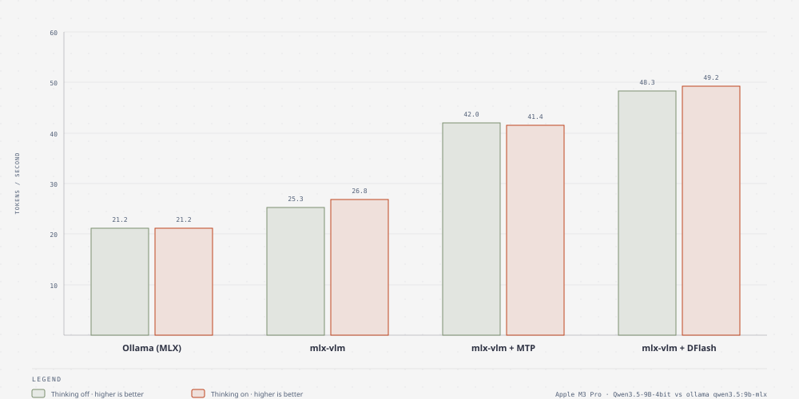
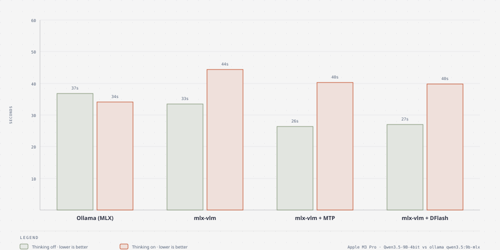

# pi-mlx-vlm

Local MLX models for the [Pi](https://github.com/earendil-works/pi) coding agent, with speculative decoding (MTP and DFlash). Inference runs on [mlx-vlm](https://github.com/Neywa-Labs/mlx-vlm); this package is glue. It registers an `mlx` provider, installs models together with their drafters, and runs one mlx-vlm server on `127.0.0.1:8080`, next to Ollama, without conflicting with it.

Everything is free and local. No hosted APIs.

## Speed

<!-- bench:start -->




| Engine | Decode tok/s, thinking off | Decode tok/s, thinking on | Pi task, thinking off | Pi task, thinking on | Task tests passed |
|---|---|---|---|---|---|
| Ollama (MLX) | 21.2 (1.00×) | 21.2 (1.00×) | 37 s | 34 s | 6/6 |
| mlx-vlm | 25.3 (1.20×) | 26.8 (1.26×) | 33 s | 44 s | 6/6 |
| mlx-vlm + MTP | 42.0 (1.98×) | 41.4 (1.95×) | 26 s | 40 s | 6/6 |
| mlx-vlm + DFlash | 48.3 (2.28×) | 49.2 (2.32×) | 27 s | 40 s | 6/6 |

Apple M3 Pro, `mlx-community/Qwen3.5-9B-4bit` on mlx-vlm vs `qwen3.5:9b-mlx` on Ollama, 2026-11-25. Decode: mean of 9 streamed 512-token generations (3 prompts) with Qwen's sampling for each mode; × is relative to Ollama. Pi task: `Create fib.py with fib(n) returning the nth Fibonacci number (fib(0)=0) and test_fib.py with 3 unittest cases. Run python3 -m unittest and report the result.`, mean of 3 runs of `pi -p` with prefix caching on for both engines. Raw numbers in [bench/results.json](bench/results.json).
<!-- bench:end -->

### 27B: Ollama's tag already speculates

On `qwen3.8:27b-mlx` vs `mlx-community/Qwen3.8-27B-4bit`, the result flips. The Ollama tag ships its own MTP head (`mtp.*` tensors in `ollama show -v`), and Ollama runs it. The 9B tag has no MTP head. On the same M3 Pro, Ollama's built-in MTP is ~25% faster than mlx-vlm's MTP or DFlash2:

| Engine | Decode tok/s, thinking off | Decode tok/s, thinking low | Pi task, thinking off | Pi task, thinking low | Task tests passed |
|---|---|---|---|---|---|
| Ollama (MLX, built-in MTP) | 23.5 (1.00×) | 21.8 (1.00×) | 68 s | 70 s | 2/2 |
| mlx-vlm | 8.7 (0.37×) | 8.6 (0.40×) | 105 s | 112 s | 2/2 |
| mlx-vlm + MTP | 18.0 (0.77×) | 16.4 (0.75×) | 81 s | 85 s | 2/2 |
| mlx-vlm + DFlash2 | 18.7 (0.79×) | 16.3 (0.75×) | 83 s | 83 s | 2/2 |

Same prompts and task, 1 run each (decode: mean of 3 generations), 2026-11-25. Ollama's native `eval_duration` agrees (22.5 tok/s). Raw numbers in [bench/results-27b.json](bench/results-27b.json). On bigger chips the balance may differ, so rerun `node bench/bench.ts --ollama qwen3.8:27b-mlx --mlx mlx-community/Qwen3.8-27B-4bit --thinking off,low --out bench/results-27b.json` before switching a 27B setup.

## Install

```sh
pi install git:github.com/tctsung/pi-mlx-vlm
```

Then inside Pi:

```text
/mlx setup
```

`/mlx setup` asks before running `uv tool install mlx-vlm` and `uv tool install huggingface_hub`. It then offers the MLX equivalents of the Ollama models you have installed, pulls the one you pick with both drafters, starts the server, and switches the session to its `@dflash` entry. In `/model`, press `Ctrl+S` to make that model the default.

### Migrate from Ollama in one line

```sh
uv tool install mlx-vlm && uv tool install huggingface_hub && pi install git:github.com/tctsung/pi-mlx-vlm && pi -p "/mlx setup"
```

Without a UI, `/mlx setup` picks the MLX match of your first installed Ollama model (for example `qwen3.8:27b-mlx` → `mlx-community/Qwen3.8-27B-4bit`). To choose a model explicitly, pass it: `pi -p "/mlx setup mlx-community/Qwen3.8-27B-8bit"`. Then start Pi with `pi --model "mlx/mlx-community/Qwen3.8-27B-4bit@dflash"`, or pick the model in `/model` and press `Ctrl+S`.

Migrating pays off where the Ollama tag has no MTP head of its own (the 9B: 2.3× decode with DFlash). For `qwen3.8:27b-mlx`, see the 27B table above first. Both providers stay available, so you can A/B in `/model` before choosing a default.

If you used an Ollama Pi extension, remove it with `pi remove <source>` (`pi list` shows the source). Ollama itself stays installed on port 11434 and remains reachable as `ollama/*`.

## Use

| In Pi | What it does |
|---|---|
| `/model` | Each pulled model has three entries: `mlx/<repo>` (no drafter), `mlx/<repo>@mtp`, `mlx/<repo>@dflash`. Switching between them, or to `ollama/*`, needs no restart. |
| `/thinking` | Qwen3.8: `off`, `low`, `medium`, `high` (sent as `xhigh`). Qwen3.5: `off` or `medium` (on). This is the biggest speed lever. On Qwen3.8, the first request after a change re-reads the whole prompt (see [NOTES.md](NOTES.md)). |
| `/mlx setup [repo]` | Installs mlx-vlm (after asking), pulls a model with its drafters, starts the server. |
| `/mlx pull <repo> [mtp\|dflash] [--draft <repo>]` | Like `ollama pull`. Downloads the target and the MTP drafter with `hf download`, and converts the DFlash drafter to 4-bit with `mlx_vlm.convert`. For models not in the catalog, pass `--draft`. |
| `/mlx status` | Shows server state, loaded model, active drafter and pulled entries. |
| `/mlx unload` | Frees the model's memory. The server stays up. To stop it entirely: `pkill -f mlx_vlm.server`. |

The server starts on the first `mlx/*` request, or with `/mlx setup`. Before each request, the extension switches the drafter at runtime with `PATCH /v1/settings`. Nothing is restarted.

## Catalog

Only drafter repos that were checked to exist are listed:

| Target | MTP drafter | DFlash drafter | Ollama tags it replaces |
|---|---|---|---|
| `mlx-community/Qwen3.8-27B-8bit` | `mlx-community/Qwen3.8-27B-MTP-4bit` | `z-lab/Qwen3.8-27B-DFlash2` → 4-bit | |
| `mlx-community/Qwen3.8-27B-4bit` | `mlx-community/Qwen3.8-27B-MTP-4bit` | `z-lab/Qwen3.8-27B-DFlash2` → 4-bit | `qwen3.8:27b-mlx`, `qwen3.8:27b` |
| `mlx-community/Qwen3.5-9B-4bit` | `mlx-community/Qwen3.5-9B-MTP-4bit` | `z-lab/Qwen3.5-9B-DFlash` → 4-bit, block 4 | `qwen3.5:9b-mlx`, `qwen3.5:9b` |

Any other mlx-vlm model works with `/mlx pull <repo> dflash --draft <drafter-repo>` (or `mtp`).

## Files

| Path | Contents |
|---|---|
| `~/.pi/agent/mlx-vlm.json` | Pulled pairings (the source of the `/model` list) |
| `~/.pi/agent/mlx-vlm/drafters/` | 4-bit converted DFlash drafters |
| `~/.pi/agent/mlx-vlm/server.log` | mlx-vlm server log |
| `~/.cache/huggingface/` | Model weights, shared with other HF tools |

## Safety

- The server always runs with `--host 127.0.0.1` (mlx-vlm's default is `0.0.0.0`). Nothing listens beyond localhost, so no API key is needed.
- Installs run only after a confirm prompt. Nothing is deleted, and Ollama is untouched.

## Develop

```sh
npm install
npm test            # unit tests + fake mlx-vlm server + fake Pi
npm run typecheck   # against @earendil-works/pi-coding-agent types
npm run e2e         # real Pi + mlx-vlm + Ollama, fresh agent dir
npm run bench       # Ollama vs mlx-vlm / MTP / DFlash, writes bench/results.json
node bench/chart.ts # redraws docs/speed-*.html from results.json
```

Design notes, Phase 0 findings and known gaps: [NOTES.md](NOTES.md).
