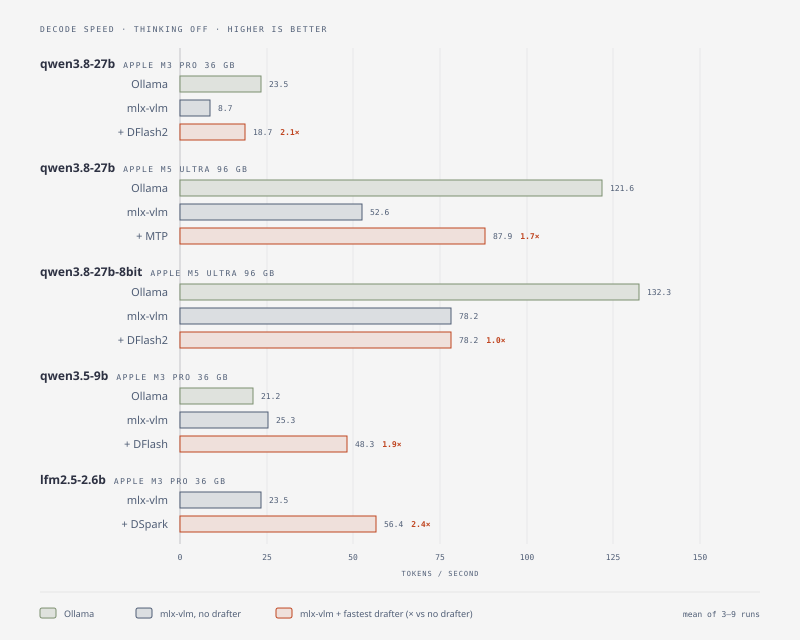

# Notes

Design notes and Phase 0 findings. Code has no inline comments; anything worth explaining lives here.

## Phase 0: what was verified by hand

Machine: Apple M3 Pro, 36 GB. mlx-vlm 0.8.1 (PyPI, same as `main` on 2026-11-24), Pi 1.6.0, Ollama 0.40.18.
Test model `mlx-community/Qwen3.5-9B-4bit` with `mlx-community/Qwen3.5-9B-MTP-4bit` (164 MB) and `z-lab/Qwen3.5-9B-DFlash` (2.6 GB bf16, 694 MB at 4-bit).

| Check | Result |
|---|---|
| Server bind | `--host 127.0.0.1` gives `TCP 127.0.0.1:8080 (LISTEN)` in `lsof`. The default would be `0.0.0.0`. |
| Pi chat through `openai-completions` | Text, streamed `delta.reasoning` (shown as thinking), and streamed tool calls all work. |
| `PATCH /v1/settings {draft_model, draft_kind}` | Applied live; `reload_kinds: ["text_generation"]`; the next request reloads the target with the new drafter in a few seconds. One server is enough, so there's no per-pairing process. |
| `draft_model: null` | Only turns drafting off if the server was **started without** `--draft-model`. The CLI flag is copied into `MLX_VLM_DRAFT_MODEL`, and `null` falls back to it. So the extension starts the server bare and sets every drafter through PATCH. |
| Sampling defaults | mlx-vlm defaults to greedy (`temperature 0`). The extension sends each family's Ollama Modelfile values through Pi `samplingParams`, so both engines sample the same way: Qwen3.5 `temperature 1, top_k 20, top_p 0.95, presence_penalty 1.5` (thinking off: `0.7 / 0.8`); Qwen3.8 `temperature 1, top_k 20, top_p 0.95` with no presence penalty. |
| Keep-alive and queue | With `PI_MLX_KEEP_ALIVE=20s` on the 9B, the model was loaded at 15 s and unloaded by 40 s; the next request reloaded it in 17 s. The watchdog exited when the server was killed. Two concurrent requests with `MLX_VLM_MAX_NUM_SEQS=1` both completed, one after the other. |
| Thinking control | `reasoning_effort` maps to `enable_thinking` plus a template kwarg. `none` turns thinking off. The Qwen3.8 template accepts `low / medium / xhigh` (default `xhigh`); the Qwen3.5 template only supports on/off. |

## Benchmarks



Drawn by `bench/chart.ts` from `bench/results.json`, on the M3 Pro (36 GB) only so far. Ollama's `qwen3.8:27b-mlx` tag has MTP built in, which is why it leads on the 27B.

Next: run the bench on a Mac Studio and a 16 GB MacBook Pro, then put the chart in the README. On 16 GB, skip the 27B and 31B models (16-18 GB of weights) and use qwen3.5-9b, qwen3.5-4b, gemma4-e4b and lfm2.5-2.6b.

## Findings that changed the design

1. **Prefix cache matters more than the drafter for agent work.** A 4-turn Pi task sends ~5.3K prompt tokens per turn. With mlx-vlm's APC off (its default), every turn re-prefills: 78 s for the task. With `APC_ENABLED=1` it takes 31 s, and 15.8K of 21.4K prompt tokens are read from cache. So the extension starts the server with APC on by default, memory tier only (`APC_DISK_ENABLED=0`, so no silent 20 GB disk cache).
2. **DFlash block size is hardware-sensitive.** Qwen3.5-9B DFlash ships `block_size: 16`. Server tok/s on the M3 Pro, same three prompts, sampled:

   | block | 16 | 8 | 6 | 5 | 4 | 3 | MTP | no drafter |
   |---|---|---|---|---|---|---|---|---|
   | tok/s | 34-41 | 42-46 | 44-49 | 44-49 | **47-55** | 41-44 | 40-43 | 25 |

   The upstream DFlash2 PR (#2014) found the same on an M5 Max (3 rows beat 4 and 5), and DFlash2 defaults to 3 rows. The catalog writes `block_size: 4` into the converted Qwen3.5-9B drafter. Qwen3.8 DFlash2 keeps upstream's default.
3. **bf16 vs 4-bit DFlash drafter**: same speed here (28.9 vs 29.2 tok/s at block 16), and 4-bit saves ~1.9 GB, so `pull` always converts.
4. **Ollama's own MTP tag** (`qwen3.5:9b-mtp-q4`) fails to pull on Ollama 0.40.18 (`file does not exist`), so the Ollama baseline is the MLX tag `qwen3.5:9b-mlx` (nvfp4). That matches the "-mlx" tags in the current setup.
5. **With thinking on, task time follows thinking length, not decode speed.** Decode stays ~2.3× faster with DFlash, but on the 9B the mlx runs wrote 870-921 output tokens per task versus Ollama's 663, so the task-time bars are close. Thinking off is the fair comparison for raw speed.
6. **Switching entries reloads the model.** A drafter change makes the server reload the target on the next request and drops the prefix cache. On the 9B the first request after a switch takes ~15 s; later requests are warm.
7. **Ollama's 27B MLX tag has MTP built in.** `qwen3.8:27b-mlx` contains `mtp.*` tensors and Ollama 0.40.18 speculates with them: 23.5 tok/s (22.5 by Ollama's own `eval_duration`), against 18.0 for mlx-vlm + MTP (drafter `block_size: 3`, adaptive) and 18.7 for DFlash2 (adaptive, starts at 3 rows, ceiling 5) on the M3 Pro. Plain mlx-vlm gets 8.7, which is about the memory-bandwidth limit for an 18 GB dense model. DFlash2's block sizing is already adaptive upstream, so no sweep was done.

8. **Small catalog pairs, measured through Pi** (`pi -p`, thinking off, same coding prompt, ~5K-token Pi prompt, server decode tok/s). LFM2.5-2.6B (bf16) with DSpark: 44-58 against 23 without, and the same text both ways (LFM's greedy default). `bench/bench.ts` on it, 9 generations each: 56.4 against 23.5 tok/s (2.4×), and the Pi agent task in 20 s against 43 s, tests passing every time. Gemma 4 E4B (4-bit) with its MTP assistant: 55 against 39. Both drafters load as-is from Hugging Face, with no conversion.

9. **Quantization.** The catalog's `-4bit` and `-8bit` repos are mlx-community conversions made with mlx-vlm's own `mlx_vlm.convert` (the model cards say so): affine quantization, group size 64, a bf16 scale and bias per group. That is about 4.5 bits per weight at 4-bit and 8.5 at 8-bit, plus small unquantized parts, so Qwen3.8-27B is 16.1 GB at 4-bit and 29.5 GB at 8-bit, not exactly double. mlx-vlm loads these files as-is. The DFlash drafters are converted the same way at pull. 8-bit is close to lossless; 4-bit costs a little quality for about half the memory and faster decode, the usual choice on a laptop. Ollama's `-mlx` tags use NVFP4 instead (4-bit floats with a scale every 16 weights), so the Ollama bars compare a slightly different 4-bit format. LFM models run from Liquid's own bf16 weights.
10. **Bench results are one file of samples.** `bench/bench.ts` appends one row per generation or task (`machine`, `model`, `config`, `thinking`, `kind`, then `tps`/`ttft`/`tokens` or `secs`/`ok`/`turns`). `bench/chart.ts` reads every `bench/*.json`, so results copied from another machine just sit next to it, and the chart averages all runs per model, machine and config. Reruns add samples instead of overwriting.

## Design choices

- **One provider, one server, many entries.** `/model` entries are `mlx/<name>` and `mlx/<name>@<method>`, where `<name>` is the catalog name or, for other models, the repo. Before each request, `before_provider_request` (awaited by Pi) starts the server if it's down, PATCHes the drafter only when it differs, and rewrites `payload.model` to the bare repo.
- **Plain entry kept.** `mlx/<repo>` (no drafter) costs nothing extra and makes a three-way A/B possible.
- **Catalog file** `~/.pi/agent/mlx-vlm.json` holds pulled pairings. The model list comes from it, not from `/v1/models`, which also lists drafters.
- **Models live in `~/.pi/agent/mlx-vlm/models/<org>/<repo>`** (`PI_MLX_MODELS` moves it, like `OLLAMA_MODELS`). mlx-vlm and mlx-lm themselves just load Hugging Face repo ids, which lands weights in `~/.cache/huggingface/hub`, a cache by name that cleanup tools and `hf cache prune` treat as disposable, and Pi has no model folder of its own (its home is `~/.pi/agent`). So `pi-mlx` downloads with `hf download <repo> --local-dir <folder>` next to Pi's other data, Pi sends that folder path as the model, and each model is one folder to inspect or remove. `hf` still resumes, verifies and skips files that are already there. A DFlash drafter's bf16 source goes to a temp folder, is converted to 4-bit into `models/z-lab/<name>-4bit`, and the bf16 copy is deleted. Entries pulled before this (no `path`) keep loading from the Hugging Face cache. Moving an existing cache copy costs nothing on APFS: `cp -cRL <snapshot> <folder>` clones the files, and the next `pi-mlx pull` finds them in a few seconds.
- **The server is detached.** It outlives Pi, like Ollama, so the model stays warm between sessions. mlx-vlm has no idle unload, so `src/keepalive.mjs` runs next to it with the server's pid. It polls `/metrics` and POSTs `/unload` once `summary.in_flight` is 0 (queued requests count as in flight) and `last_request_at` is older than `PI_MLX_KEEP_ALIVE`. It exits when the pid is gone. It is plain `.mjs` because Node won't strip types under `node_modules`.
- **Server env defaults** (`SERVER_ENV`): APC on, memory tier only, and `MLX_VLM_MAX_NUM_SEQS=1` (Ollama's MLX scheduler also logs `parallel=1`; extra requests queue). They are merged under `process.env`, so the user's own `MLX_VLM_*` and `APC_*` values win. The only new variables are `PI_MLX_PORT` (default 8080; Ollama stays on 11434) and `PI_MLX_KEEP_ALIVE`, which mlx-vlm has no equivalent for.
- **Binaries** are looked up in `~/.local/bin` (uv's tool dir) and then `PATH`, so a fresh shell works right after `uv tool install`.
- **Pulling happens in a terminal, not in Pi.** A Pi command handler holds the editor until it returns and `pi.exec` buffers output, so a 16 GB download inside Pi looked frozen. `bin/pi-mlx.mjs` runs `hf`, `mlx_vlm.convert` and `uv` with inherited stdio, so their own progress bars show, each step is numbered (`[2/4] DFlash drafter ...`), and Ctrl+C stops it. Its picker is ~25 lines over `readline` keypress events instead of a prompt library. Pi watches `~/.pi/agent/mlx-vlm.json` (`fs.watchFile`, 2 s) and re-registers the provider, so new models show up in `/model` in a running session. The CLI is `.mjs` and shares `src/models.mjs` with the extension because Node refuses to strip TypeScript under `node_modules`, where a global npm install puts it; Pi loads `src/index.ts` through its own loader. One `npm install -g` copy serves both: `pi install "$(npm root -g)/pi-mlx-vlm"` points Pi at it, and re-running `npm install -g github:tctsung/pi-mlx-vlm` updates both (`npm update -g` checks the npm registry by name, which is wrong for a git install).
- **mlx-vlm is installed after asking.** `pi-mlx` checks for `mlx_vlm.server` and `hf`. If either is missing, it asks before running `uv tool install mlx-vlm` and `uv tool install huggingface_hub`; without a terminal it prints that command instead. Installing the package doesn't do it: mlx-vlm is a Python tool outside npm, and Ollama-backed Pi providers also need Ollama installed separately.
- **The model list is `catalog.json`.** Easy names (`qwen3.5-9b`) map to an MLX repo, a family (thinking map, sampling, context), a download size, and drafter repos per method (`mtp`, `dflash`, `dflash2`, `dspark`). It is JSON, not YAML: Node reads it with no dependency. `pi-mlx` shows pulled models first, then the catalog; re-running the install brings new entries. There is no machine-readable upstream list. mlx-vlm's "Supported Models" table (`docs/usage.md`) has 4 pairs and isn't shipped in the package. Hugging Face drafter names are inconsistent (`-MTP-4bit`, `-oQ4e-mtp`, `-mtp-msq`, `-DFlash`, `-DFlash2`, `-DFlash-b16`, `-assistant-bf16`), so auto-pairing would offer pairs that can fail after a 15 GB download. Anything else goes through `pi-mlx pull <repo> <method> --draft <repo>`.
- **Catalog entries, checked 2026-11-25.** Every repo exists and is ungated on Hugging Face. Run end to end on the M3 Pro: `qwen3.5-9b` (MTP, DFlash), `qwen3.8-27b-8bit` (MTP, DFlash2), `lfm2.5-2.6b` (DSpark), `gemma4-e4b` (MTP). The rest follow mlx-vlm's documented pairs (README "Gemma 4 MTP", z-lab model cards). Left out: Gemma 4 EAGLE-3 (RedHatAI speculators; a third drafter kind for the same models), the community `rasyosef/LFM3-1.7B-DSpark` (LFM3 has no official drafter), and LFM3 4-bit repos (mlx-community has none, so LFM3 runs from Liquid's bf16 weights).
- **Method to server kind.** mlx-vlm has `draft_kind` `mtp` and `dflash`; `dflash` auto-detects DFlash, DFlash2 and DSpark from the drafter config. Entry ids keep the method (`@dflash2`, `@dspark`) so `/model` says which one runs. DFlash and DFlash2 drafters are converted to 4-bit; MTP, Gemma 4 assistant and DSpark drafters are small and downloaded as-is. `pi-mlx pull` lists the new `/model` entries fastest first: DFlash2, DFlash, DSpark, MTP, none.
- **Command name.** If another extension also registers `/mlx`, Pi renames both to `/mlx:1` and `/mlx:2` rather than failing.
- **Port conflicts move the server.** `/health` on mlx-vlm always answers 200 with a `loaded_model` key, even while loading. So a port is mlx-vlm (share it), free (nothing answers and it binds), or another app's. At `session_start`, which Pi awaits before the first prompt, another app's port makes the extension pick a free loopback port, save it to `~/.pi/agent/mlx-vlm/port`, re-register the provider (Pi refreshes the current model's base URL) and say so. The same check runs before each request as a fallback; if the port is taken mid-session, that one request goes to the old port (Pi builds the HTTP client before the hook runs) and the user is told to resend. A second Pi session reads the saved port and shares the server, so it doesn't start another. A probe that times out (the port accepted but didn't answer in 3 s) counts as a busy mlx-vlm, never as another app, so a stalled server can't lead to a second model in memory. An explicit `PI_MLX_PORT` is never moved; a conflict there is an error. Other apps' processes are never touched. Restarting after `pkill` reuses the saved port.

## Safety

- The server binds `127.0.0.1` only (asserted in unit tests and in `test/e2e.ts` with `lsof`). No API key is used on loopback, and no port is published.
- `uv tool install` runs only after a yes in the terminal.
- `pi-mlx rm` deletes only folders under the models folder that no other pulled model uses.
- Nothing is deleted. Ollama and its models are untouched.

## Known gaps

- Running an Ollama model and an mlx model back to back keeps both in memory until each engine's keep-alive expires (5 minutes each by default). Lower `PI_MLX_KEEP_ALIVE` and `OLLAMA_KEEP_ALIVE` if memory is tight.
- The watchdog starts only when the extension starts the server. A server you start by hand never unloads on its own.
- `--draft <repo>` with both methods uses the same repo for both; pass one method with `--draft`.
- The drafter is a server-wide setting. Two Pi sessions using different `mlx/*` entries at the same time make the server reload on every switch. Use one entry per machine at a time, or the fallback from the plan: one server per pairing on separate ports.
- Changing `/thinking` on Qwen3.8 re-reads the whole prompt once. The template puts the reasoning-effort sentence at the start of the system prompt, so any prefix cache misses. On the 27B, the first request at a new level took ~50 s for Pi's ~5K-token prompt, against 12 s at a cached level. Ollama does the same: with a 2.3K-token system prompt, a low→medium change took 21.4 s of prefill against 0.12 s cached. llama.cpp's prompt cache also reuses only a shared prefix. So this is how the model works, not an extension gap.
- `/thinking` shows only the levels a model's chat template understands, set per family in `FAMILIES`. Qwen3.8 takes `low / medium / xhigh` (shown as low, medium, high); Qwen3.5, Gemma 4 (`enable_thinking`) and others are on/off, so Pi shows `off` and `medium`. Ollama lists more levels, but for these models it maps every level above off to the same `think: true`. LFM2.5's template always opens a `<think>` block, so it thinks even at `off`.
- The DFlash block size only affects speed: output and memory are the same at any value. Without tuning, mlx-vlm's adaptive default (ceiling = the checkpoint's `block_size`) already beats no drafter, at 34-41 tok/s vs 25 on the 9B. The catalog writes `block_size: 4` at pull for the measured 47-55 tok/s. DFlash2 (27B) adapts on its own. Re-check on other chips with `bench/bench.ts` if desired.

## Develop

Node 22.19+ is Pi 1.6's own requirement (`engines` in its package.json); Node 22 is an LTS line from 2024, and 24 works too. The `pi-mlx` CLI is plain JavaScript and also runs on Node 18 and 20. The tests need 22.18+ because they run `.ts` files directly.

Before pushing or copying to another Mac: `npm install`, `npm test`, `npm run typecheck`, `npm run e2e` (needs Ollama and a pulled qwen3.5-9b; set `PI_MLX_PORT=8090` to leave a running server alone), `npm pack --dry-run` to see the files a global install gets, then commit so `git status` is clean.

```sh
npm install
npm test            # unit tests + fake mlx-vlm server + fake Pi
npm run typecheck   # against @earendil-works/pi-coding-agent types
npm run e2e         # real Pi + mlx-vlm + Ollama, fresh agent dir
npm run bench -- --model qwen3.5-9b --ollama qwen3.5:9b-mlx   # appends samples to bench/results.json
npm run bench -- --model lfm2.5-2.6b --thinking off             # no Ollama counterpart: omit --ollama
node bench/chart.ts # redraws bench/speed.svg from every bench/*.json, averaging all runs per model, machine and drafter
```
